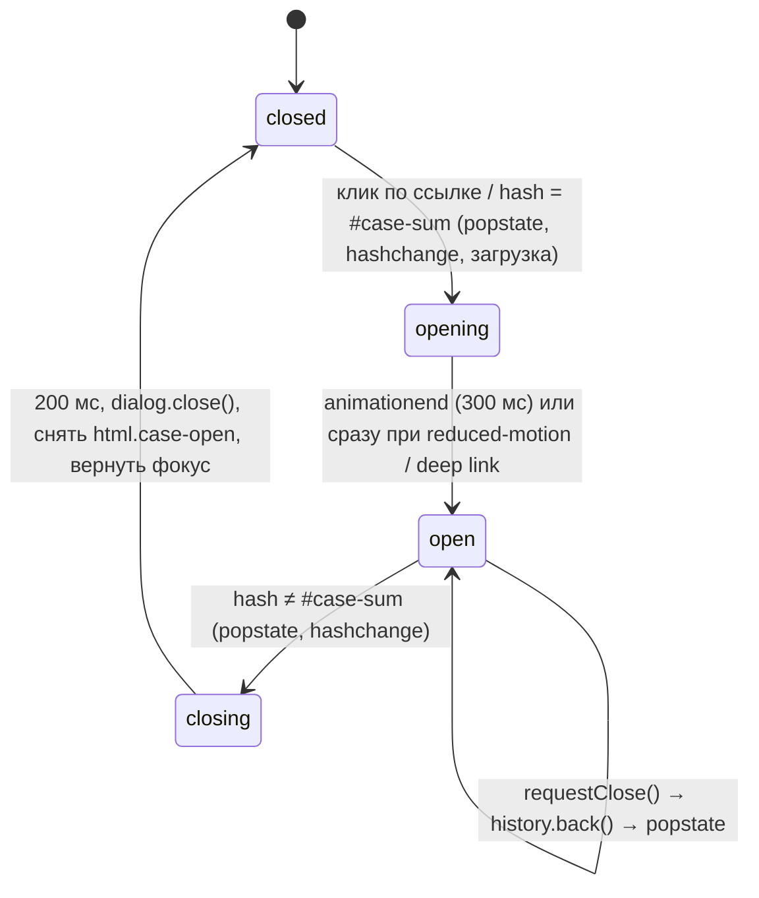

# Поп-ап кейса на kurachev.art: флоу и поведение

Дата: 2026-10-23. Задача 2 фазы 2. Входы: `.studio/ux/behance-popup.md`, `.studio/ux/case-sum.md`, код `index.html`, `js/main.js`, `js/SmoothScroll.js`, `css/*` (только прочитаны).

Решения Артёма, на которых всё стоит:
- Макета нет. Поп-ап делаем 1 в 1 как на Behance: вид, шапка, фон, анимация, крестик, мобильная версия.
- Слайды показываем ровно как в Figma (картинки 1920 px, стопкой, без зазоров).
- Прямая ссылка `#case-sum` пропускает прелоадер и сразу открывает кейс.

Пометки: **«по наблюдению»** значит, что число взято из памяти об интерфейсе Behance, а не замерено (behance.net из этой среды не открывается). **«допущение»** значит, что это моё решение, которое Артём может поменять.

---

## 0. Коротко для frontend-dev

1. Разметка: `<dialog id="case-sum-dialog">` в `index.html` после `</footer>`. Все 22 слайда лежат внутри статично, с `loading="lazy"` и `width`/`height`.
2. Логика в отдельном файле `js/case-popup.js` (`defer`, подключить после `main.js`). Причина: если CDN three.js не загрузится, `main.js` падает на строке 350 (`new THREE.Scene()`), и всё, что ниже, не выполняется. Поп-ап не должен от этого зависеть.
3. Состояние «открыт или закрыт» определяет только URL. Хеш `#case-sum` есть, значит поп-ап открыт. Все способы закрытия вызывают одну функцию `requestClose()`, а она всегда идёт через историю.
4. Блокировка скролла главной: класс `case-open` на `<html>` (`overflow: hidden`). `body.style` не трогать: им управляет прелоадер.
5. В `main.js` нужны три маленьких правки, поведение главной не меняется (раздел 6): вынести вход на сайт в функцию `enterSite()`, пропускать прелоадер при `#case-sum`, ставить 3D и видео на паузу по событиям поп-апа.
6. Внутри поп-апа вернуть нативный курсор. Сейчас на сайте `cursor: none` (global.css:13, 22), а кастомный `.cursor` (z-index 727) рисуется **под** top layer диалога. Без этой правки внутри поп-апа курсора не будет вообще.
7. Размеры в поп-апе задавать в `px`, не в `rem`: у `html` стоит `font-size: .8vw` (global.css:2), и `rem` масштабируется вместе с окном.

---

## 1. Точка входа

**Где:** главная → секция `#projects` → строка «СУМ / Urban Intel / 2o24» (`index.html:490`, `a.projectLink`).

**Сейчас:** `href` ведёт на Behance, `target="_blank"`. Наведение показывает превью `.projectPreview` (main.js:561–577), по hover строка раскрывается маской (`.texxt-hover`).

**Станет:**
```html
<a href="#case-sum" class="projectLink" data-case="sum"
   data-behance="https://www.behance.net/gallery/257238445/sum-upravlenie-videostenoj-UXUI-Redesign"
   data-preview="./img/projects/sum.jpg" aria-haspopup="dialog">
```
- `href="#case-sum"`, без `target="_blank"`. Тогда Cmd/Ctrl/средний клик и «Копировать адрес ссылки» дают `kurachev.art/#case-sum`, то есть deep link на кейс на нашем сайте, а не Behance.
- Ссылку на Behance переносим в футер поп-апа («Смотреть на Behance»).
- Почему не оставить Behance в `href` как запасной путь без JS (как предлагал behance-popup.md): без JS главная и так не работает, потому что прелоадер снимается только скриптом. Запасной путь, которым нельзя воспользоваться, ничего не даёт, а `#case-sum` в `href` даёт рабочий deep link. *Допущение, нужно подтверждение Артёма.*
- Остальные 4 проекта пока не трогаем: они ведут на Behance, как сейчас.

**Клик:**
| Действие | Результат |
|---|---|
| Обычный клик или тап | `preventDefault()` → `openCase({push: true})` |
| Cmd/Ctrl/Shift/Alt + клик, средняя кнопка | Не перехватываем. Браузер открывает `#case-sum` в новой вкладке, где сработает deep link |
| Enter на сфокусированной ссылке | То же, что клик |
| Повторный клик, пока поп-ап открыт или анимируется | Игнорируем (флаг `state !== 'closed'`) |
| Браузер без `HTMLDialogElement.prototype.showModal` (Safari < 15.4) | Не перехватываем. JS при старте подменяет `href` на `data-behance` и ставит `target="_blank"`, то есть ссылка работает как сейчас |

**Предзагрузка:** на `pointerenter` и `focus` ссылки СУМ ставим первым двум слайдам `loading="eager"`. Пока человек дотягивается до клика (обычно 200–600 мс), обложка уже грузится. Без наведения (тач) слайды начинают грузиться в момент открытия.

---

## 2. Состояния и URL

### 2.1. Машина состояний



Правило: **DOM меняет только `syncFromURL()`**. Кнопки, Esc и клик по фону меняют историю, а история вызывает `syncFromURL()`.

### 2.2. Функции (load-bearing, имена можно менять)

```js
const HASH = '#case-sum';

function syncFromURL() {            // слушает popstate и hashchange, вызывается при старте
  const want = location.hash === HASH;
  if (want && state === 'closed') openCase({ push: false });
  if (!want && state === 'open')  hideCase();
}

function openCase({ push }) {
  if (push) history.pushState({ casePopup: 'sum' }, '', HASH);
  else if (!history.state?.casePopup) history.replaceState({ casePopup: 'sum' }, '', HASH);
  showCase();                       // DOM: showModal, класс, фокус, события (раздел 3)
}

function requestClose() {           // единственная точка входа для ВСЕХ способов закрытия
  if (state !== 'open') return;     // защита от двойного Esc, двойного клика
  if (history.state?.casePopup) history.back();   // → popstate → syncFromURL → hideCase
  else { history.replaceState(null, '', location.pathname + location.search); hideCase(); }
}
```

### 2.3. История браузера по сценариям

| Сценарий | Записи истории | «Назад» |
|---|---|---|
| Открыл с главной | `/` → `/#case-sum` (pushState) | Закрывает поп-ап, главная на той же позиции |
| Deep link `kurachev.art/#case-sum` | При загрузке: `replaceState('/')`, затем `pushState('#case-sum')` → `/` → `/#case-sum` | Первое «назад» закрывает поп-ап и показывает главную. Второе уводит с сайта |
| Закрыл, потом «вперёд» | `/#case-sum` снова активна | popstate → `openCase({push:false})`, поп-ап с начала |
| Вручную дописал `#case-sum` в адресной строке | Браузер сам создаёт запись, без state | hashchange → `openCase` делает `replaceState` со state, дальше всё как обычно |
| Перезагрузка с открытым поп-апом | Как deep link | Как deep link |

Почему в deep link вставляем запись главной: тогда закрытие всегда идёт одним путём (`history.back()`), и человек из письма или от рекрутера после закрытия попадает на главную, а не уходит с сайта. Поведение Behance тут другое (у Behance прямая ссылка открывает отдельную страницу), но отдельной страницы кейса у нас нет. *Допущение.*

### 2.4. Хеш и якорь

- `id` у диалога **не** `case-sum`, а `case-sum-dialog`. Иначе браузер при загрузке и при `hashchange` попробует проскроллить к элементу с этим id.
- Распознаём только точное `#case-sum`. Любой другой хеш (`#case-foo`, `#CASE-SUM`) игнорируем: обычная загрузка с прелоадером.
- Меню (`.header_menu_item a`) делает `preventDefault` и хеш не меняет, поэтому конфликтов с ним нет.

---

## 3. Открытие

### 3.1. Что происходит по шагам (`showCase`)

1. `state = 'opening'`.
2. Запомнить триггер: `lastTrigger = document.activeElement` (ссылка СУМ или `body` при deep link).
3. Подчистить hover главной: убрать `.is-visible` у `.projectPreview` и `.texxt-hover` у строки СУМ. После открытия `mouseleave` может не прийти, и превью останется висеть под поп-апом и будет видно после закрытия.
4. Добавить `html.case-open` (блокировка скролла, раздел 5).
5. `dialog.scrollTop = 0`: каждый раз открываем с начала, как на Behance.
6. `dialog.showModal()`.
7. Фокус на заголовок кейса (`h1.case-popup__title`, `tabindex="-1"`), раздел 7.
8. `document.dispatchEvent(new CustomEvent('casepopup:open'))`: main.js ставит на паузу 3D и видео (раздел 6).
9. Анимация (3.2), по `animationend` `state = 'open'`.

### 3.2. Анимация

| Что | Открытие | Закрытие |
|---|---|---|
| Фон (сам `dialog`, `background`) | `opacity 0 → 1`, 200 мс, `ease-out` | `opacity 1 → 0`, 200 мс, `ease-in` |
| Контент (`.case-popup__inner`: шапка + полотно + футер) | `opacity 0 → 1` и `translateY(40px) → 0`, 300 мс, задержка 50 мс, `cubic-bezier(.2,.8,.2,1)` | Не двигается, исчезает вместе с фоном |
| Крестик | `opacity 0 → 1`, 200 мс | вместе с фоном |
| `prefers-reduced-motion: reduce` | Только `opacity`, 150 мс, без сдвига | Только `opacity`, 150 мс |
| Deep link | Без анимации, сразу `open` | Как обычно |

Параметры анимации «по наблюдению»: на Behance фон проявляется, а контейнер коротко выезжает снизу.

Важно: `transform` анимировать **только** у `.case-popup__inner`, не у `dialog`. Если анимировать `dialog`, `position: fixed` у крестика начнёт считаться от диалога, а не от окна, и на время анимации крестик съедет.

Закрытие по шагам (`hideCase`): `state = 'closing'` → класс `is-closing` (анимация 200 мс) → `dialog.close()` → снять `html.case-open` → `casepopup:close` → вернуть фокус (раздел 7) → `state = 'closed'`. Клики по ссылке СУМ во время закрытия игнорируем.

### 3.3. Что видно под поп-апом

- Главная на той же позиции скролла (обычно секция `#projects`), затемнённая фоном диалога. При непрозрачности 0,9 она почти не видна, и это нормально для Behance.
- Главная под поп-апом не анимируется: скролл окна стоит, поэтому обработчики `scroll` (StrokeMask, маски, 3D-вращение, аватары отзывов) не вызываются. 3D-рендер и видео на паузе.
- При deep link под поп-апом лежит первый экран, уже в состоянии «после входа» (раздел 6.2).

---

## 4. Вид: 1 в 1 как Behance

### 4.1. Слои

```
<dialog id="case-sum-dialog" class="case-popup" aria-labelledby="case-sum-title">   ← на весь экран, фон, скроллится
  <button class="case-popup__close" aria-label="Закрыть кейс">×</button>            ← position: fixed
  <div class="case-popup__inner">                                                    ← анимируется
    <header class="case-popup__head"> аватар · название · автор </header>           ← на тёмном фоне, над полотном
    <div class="case-popup__canvas"> 22 ×  </div>                              ← полотно кейса
    <footer class="case-popup__foot"> название · CTA · Behance </footer>            ← полоса под полотном
  </div>
</dialog>
```

### 4.2. Десктоп и планшет (> 768 px)

| Параметр | Значение | Статус |
|---|---|---|
| `dialog` | `position: fixed; inset: 0; width: 100%; height: 100%; max-width: none; max-height: none; margin: 0; padding: 0; border: 0; overflow-y: auto; overscroll-behavior: contain; color: #fff` | Механика |
| `::backdrop` | `background: transparent` (затемнение рисует сам `dialog`, так его проще анимировать одним `opacity`) | Механика |
| Фон `dialog` | `rgba(0, 0, 0, 0.9)` | По наблюдению |
| Ширина полотна | `width: min(1400px, 100vw − 160px)` при ≥ 1280 px; `100vw − 96px` при 1024–1279; `100vw − 48px` при 769–1023. Центр по горизонтали | 1400 по наблюдению + [S4]; поля допущение |
| Пример ширины полотна | 1920 → 1400 · 1536 → 1376 · 1440 → 1280 · 1280 → 1120 · 1024 → 928 · 800 → 752 | Расчёт |
| Шапка над полотном | Высота 88 px: `padding: 24px 0`, ширина = ширине полотна, выравнивание по левому краю полотна | По наблюдению |
| Аватар | Круг 40 × 40, `margin-right: 12px` | По наблюдению |
| Название кейса | 20 px / 24 px, weight 700, `#fff`, одна строка, `…` при переполнении | По наблюдению |
| Строка автора | 14 px / 18 px, `rgba(255,255,255,.7)`: «Артём Курачев» | По наблюдению |
| Шрифт шапки и футера | Montserrat 600/700 (уже подключён, `--text-block`). На Behance другой шрифт | Допущение |
| Крестик | `position: fixed; top: 24px; right: 24px`, зона 40 × 40, иконка 20 × 20, линия 2 px, `#fff`, без фона и рамки. Hover: `opacity .7`. Всегда виден, не скроллится | По наблюдению; X подтверждён [S1] |
| Полотно | Фон `#09090A` (фон слайдов), без скругления, без тени, без зазоров между слайдами (`display: block` у `img`, `line-height: 0`) | Скругление и тень по наблюдению |
| Слайд | `width: 100%; height: auto; display: block` | Из Figma |
| Футер под полотном | Фон `#191919`, на ширину полотна, `padding: 56px 40px`, содержимое по центру | По наблюдению |
| Отступ после футера | `padding-bottom: 80px` у `.case-popup__inner` | По наблюдению |
| Боковая колонка действий Behance (Follow, Like, Save, Share) | **Не делаем в MVP** | См. вопрос 2 |

Содержимое футера (тексты окончательно в задаче 4):
- название кейса 28 px / 700 и подзаголовок «UX/UI Redesign · 2024» 14 px `rgba(255,255,255,.6)`;
- кнопки в ряд, `gap: 12px`: основная «Написать в Telegram» → `https://t.me/artkurachev` (`target="_blank"`), вторичная «Смотреть на Behance» → `data-behance` (`target="_blank"`);
- ниже текстовая кнопка «Вернуться к проектам», вызывает `requestClose()`.
- Кнопки 48 px высотой, радиус 24 px. Основная: фон `#E9D4C3`, текст `#0D0D0D`. Вторичная: рамка 2 px `#E9D4C3`, текст `#E9D4C3`. Это цвета кнопки прелоадера (style.css:29), то есть фирменные цвета сайта.

Тёмные слайды на тёмном фоне почти сливаются с ним. На Behance тёмные проекты выглядят так же, поэтому ничего специально не выделяем.

### 4.3. Мобильная версия (≤ 768 px, брейкпоинт как в media.css)

Как на Behance с телефона: проект на весь экран, фон главной не виден.

| Параметр | Значение | Статус |
|---|---|---|
| Фон `dialog` | `#000` непрозрачный | По наблюдению |
| Верхняя панель | `position: sticky; top: 0`, высота 56 px, фон `#000`, `padding: 0 4px 0 16px`. Слева аватар 32 px и название 16 px / 600 в одну строку с `…`, справа крестик | По наблюдению |
| Крестик | Внутри панели, зона 44 × 44, иконка 20 px. На мобильных `position: fixed` не используется, крестик живёт в sticky-панели | Механика |
| Строка автора | Скрыта, остаётся только в футере | Допущение |
| Полотно | `width: 100vw`, без полей, слайды на всю ширину | [S4] |
| Футер | `padding: 40px 16px`, кнопки в столбик на всю ширину, 48 px | Допущение |
| Анимация | Как на десктопе (fade + `translateY(40px)`, 300 мс) | По наблюдению |
| Безопасные зоны | В viewport-мете нет `viewport-fit=cover`, поэтому отступы `env(safe-area-inset-*)` равны 0. Сейчас ничего не делаем, но если мету поменяют, панели нужен `padding-top: env(safe-area-inset-top)` | Механика |
| Высота | `inset: 0` у fixed-диалога, никаких `100vh` (на iOS это ломается из-за адресной строки) | Механика |
| Зум | Pinch-zoom страницы разрешён (мета его не запрещает). Мелкий текст слайдов 01, 03, 05, 07, 09, 11 на 375 px без зума не прочитать (case-sum.md). В MVP оставляем системный зум | Известный риск |

Жесты: свайп вниз для закрытия не делаем, на Behance его нет. Закрывают крестиком в панели или системным «назад».

### 4.4. Картинки слайдов

```html

```
- `width`/`height` берём из таблицы case-sum.md (1920 × высота слайда). При `width:100%; height:auto` браузер заранее резервирует место по пропорции, и скролл не прыгает, пока картинки догружаются.
- `loading="lazy"` у **всех 22**, включая первые два. Если первые сделать `eager`, они загрузятся вместе с главной, хотя диалог закрыт, а это ~0,5 МБ впустую. Первые два догружаются по наведению (раздел 1) или в момент открытия. Пока диалог закрыт (`display: none`), ленивые картинки не грузятся.
- У первого слайда `fetchpriority="high"`.
- Lazy loading работает и внутри прокручиваемого диалога: браузер считает пересечение с окном. Проверить в Safari (чек-лист, п. 12).

---

## 5. Блокировка скролла главной

```css
html { scrollbar-gutter: stable; }          /* всегда: в Firefox страница не сдвинется при блокировке */
html.case-open { overflow: hidden; }
```
- Почему `html`, а не `body`: прелоадер пишет `document.body.style.overflowY` (main.js:8 и :56), и инлайновый стиль перезапишет наш. Класс на `html` с ним не пересекается. При `overflow: hidden` у `html` прокрутка вьюпорта блокируется, а `body { overflow-y: auto }` из global.css на это не влияет, потому что у `body` нет ограниченной высоты.
- `scrollY` окна не меняется, поэтому после закрытия главная остаётся ровно там же. Сохранять и восстанавливать позицию вручную не нужно.
- **Не использовать** `body { position: fixed; top: -Ypx }`. Этот приём сбрасывает `scrollY` в 0, на это срабатывают все `scroll`-обработчики (StrokeMask, маски строк, аватары отзывов, `--scrollTop`), и под поп-апом и после закрытия будут видны скачки.
- iOS: `overflow: hidden` на `html` работает с iOS 16. Утечку скролла дополнительно гасит `overscroll-behavior: contain` у диалога. На iOS 15 и старее главная может чуть сдвигаться за пальцем у краёв, это приемлемо.
- Скроллбары: `::-webkit-scrollbar { display: none }` (global.css) действует и на диалог. В Chrome и Safari скроллбара не будет, как и на главной. Behance скроллбар показывает, но у нас общее правило сайта важнее. *Допущение.*

---

## 6. Взаимодействие с кодом главной

### 6.1. Правки в `main.js` (минимальные, поведение главной то же)

1. **Вынести вход в функцию.** Тело `document.querySelector('.preBtn').onclick` (main.js:44–63) переносим в `function enterSite({ sound = true } = {})`, а `onclick` вызывает `enterSite()`. Для обычного входа ничего не меняется.
2. **Пропуск прелоадера.** В начале `window.onload` (main.js:7): `if (document.documentElement.classList.contains('skip-preloader')) { enterSite({ sound: false }); return; }`. Важно, чтобы `return` стоял до `document.body.style.overflowY = 'hidden'`, иначе после закрытия поп-апа главная не будет скроллиться.
3. **Пауза по событиям поп-апа:**
   - `casepopup:open` → `rendererMoon.setAnimationLoop(null)`; флаг `paused = true`, который `tick()` (main.js:437–453) проверяет и пропускает `renderer.render`, при этом `requestAnimationFrame` продолжает работать; `bgVideo.pause()`, если видео играло (запомнить); `.cursor` получает `hidden-cursor`.
   - `casepopup:close` → вернуть `setAnimationLoop` с тем же колбэком, снять флаг, `bgVideo.play().catch(()=>{})`, если играло до открытия. Курсор появится сам на следующем `mousemove` (main.js:174–179).
   - `moonRotation()` и цикл курсора `render()` не трогаем, они дешёвые.

Если правки 1–3 не внести, поп-ап всё равно работает, кроме deep link: без них прелоадер останется висеть под поп-апом, и после закрытия придётся нажимать «вход».

### 6.2. Deep link и прелоадер

1. В `<head>` до подключения CSS вставить инлайн-скрипт:
   ```html
   <script>if (location.hash === '#case-sum') document.documentElement.classList.add('skip-preloader', 'case-pending');</script>
   ```
2. CSS:
   ```css
   .skip-preloader .preloader { display: none; }
   .case-pending body::after { content: ''; position: fixed; inset: 0; background: #000; z-index: 800; }
   ```
   `case-pending` закрывает первый экран чёрным, пока не открылся диалог (до `DOMContentLoaded`), чтобы главная не мелькнула. Снимаем класс сразу после `showModal()`.
3. `case-popup.js` на `DOMContentLoaded` вызывает `syncFromURL()` → `openCase({push:false})` без анимации. До этого делает `replaceState(null,'','/')` и `pushState({casePopup:'sum'},'','#case-sum')` (раздел 2.3).
4. `main.js` на `window.onload` выполняет `enterSite({sound:false})`: прелоадер уходит, `body` скроллится, анимация строк первого экрана проходит под поп-апом, `bgvideo` запускается (он `muted`, автоплей разрешён). Звук не играем: нет жеста пользователя, и звук без предупреждения сбивает.
5. Счётчик процентов (main.js:27–35) пусть тикает, он скрыт и ничему не мешает.
6. После закрытия человек видит главную вверху (первый экран), прелоадера нет, меню и скролл работают.

Край: поп-ап открыли при видимом прелоадере, не через deep link (например, дописали `#case-sum` в адресную строку до нажатия «вход»). Диалог в top layer окажется над прелоадером. После закрытия прелоадер остаётся, и надо нажать «вход», как обычно. Специально не обрабатываем.

### 6.3. SmoothScroll.js

- Работает только в десктопных Chrome, Safari и Edge (`ee = (chrome||safari) && !mobile`). В Firefox и на телефонах прокрутка нативная.
- Колесо: обработчик на `window` ищет ближайшего прокручиваемого предка цели (`overflow-y: auto|scroll` и `scrollHeight > clientHeight + 10`). Над полотном, шапкой и над тёмными полями диалога цель находится внутри `dialog`, поэтому плавно скроллится диалог. Прокрутка в поп-апе будет с той же инерцией, что на главной, и это хорошо. Ничего не меняем.
- Клавиши: SmoothScroll берёт элемент последнего `mousedown`. При открытии кликом это ссылка СУМ на главной, а её предок `html` в состоянии `overflow: hidden`, поэтому скрипт не находит скроллер и отдаёт клавишу браузеру. Браузер скроллит контейнер с фокусом, то есть диалог (фокус внутри, раздел 7). Стрелки, Space, PageUp/PageDown, Home и End работают, просто без сглаживания до первого клика внутри поп-апа. Это приемлемо, но надо проверить (чек-лист, п. 6).
- Кэш скроллеров у скрипта сбрасывается раз в секунду, поэтому после закрытия колесо снова скроллит страницу.

### 6.4. StrokeMask и другие scroll-эффекты

- Все они слушают `scroll` на `window`. Событие `scroll` диалога до `window` не доходит, так что под поп-апом эффекты стоят.
- `scrollY` не меняется (раздел 5), поэтому `clip-path` у `.mask-text-mp`, позиции аватаров и `--scrollTop` после закрытия те же, что до открытия. Двух копий `h2` поп-ап не касается.
- `window.onscroll` (вращение наушников) тоже молчит.

### 6.5. Курсор и hover-эффекты

```css
.case-popup, .case-popup * { cursor: auto; }
.case-popup a, .case-popup button { cursor: pointer !important; }   /* перебивает a { cursor: none !important } */
```
- Кастомный `.cursor` и `.projectPreview` (z-index 50) рисуются под top layer. Курсор при открытии скрываем (`hidden-cursor`), превью гасим (шаг 3 в 3.1).
- Магнитные кнопки и меню (`position: fixed`, z-index 5–100) тоже остаются под диалогом. Их `mousemove` продолжает считать притяжение, на вид это не влияет.

---

## 7. Фокус и клавиатура

| Момент | Поведение |
|---|---|
| Открытие | Фокус на `h1#case-sum-title` (`tabindex="-1"`, без видимой обводки: это не контрол). Скринридер читает «диалог, СУМ — управление видеостеной». Стрелки сразу скроллят поп-ап |
| Порядок Tab | 1) Крестик (первый в DOM) → 2) ссылки в футере: «Написать в Telegram», «Смотреть на Behance», «Вернуться к проектам» → снова крестик. В слайдах фокусируемых элементов нет |
| Ловушка фокуса | Даёт `showModal()`: всё вне диалога становится `inert`. Tab может уйти в адресную строку браузера, это нормальное поведение нативного диалога |
| Видимый фокус | `.case-popup :focus-visible { outline: 2px solid #E9D4C3; outline-offset: 3px; }` |
| Esc | Событие `cancel` → `e.preventDefault()` → `requestClose()`. Так Esc идёт через историю и анимацию |
| Space, PageUp/PageDown, стрелки, Home/End | Скроллят поп-ап. Space на крестике нажимает крестик |
| ← / → | Ничего: листать кейсы стрелками нельзя, на Behance так же. Кейс пока один |
| Закрытие (с главной) | Фокус возвращается на ссылку СУМ: `lastTrigger.focus({ preventScroll: true })`. Позиция главной не меняется |
| Закрытие (deep link) | Фокус на `body`, ссылку не фокусируем: она далеко внизу, а страница стоит вверху |

Подстраховка для Chrome: если пользователь жмёт Esc несколько раз без других действий, Chrome может закрыть диалог, не дав отменить `cancel`. Сюда же относится системное «назад» на Android: для модального `<dialog>` Chrome 120+ превращает его в `cancel` или `close`, а не в `popstate`. Поэтому слушаем ещё и `close`: если диалог закрыл браузер, а `state === 'open'`, выполняем `hideCase()` без повторного `dialog.close()` и, если `history.state?.casePopup`, делаем `history.back()` с флагом `skipNextSync`, чтобы popstate ничего не делал второй раз.

ARIA: у `dialog` есть `aria-labelledby="case-sum-title"`, роль `dialog` встроена. У крестика `aria-label="Закрыть кейс"` и `title="Закрыть (Esc)"`.

---

## 8. Все способы закрытия

Все способы вызывают одну функцию `requestClose()` (раздел 2.2).

| Способ | Устройство | Как ловим | Особенности |
|---|---|---|---|
| Крестик | все | `click` → `requestClose()` | На десктопе fixed в углу окна, на мобильных в sticky-панели |
| Esc | клавиатура | `dialog` `cancel` → `preventDefault()` → `requestClose()` | + подстраховка через `close` (раздел 7) |
| Клик по фону | десктоп, > 768 px | `pointerdown` и `click` на `dialog`: закрываем, только если **оба** события пришли на сам `dialog` (`e.target === dialog`), а не на `.case-popup__inner` | Выделение текста или перетаскивание, которое началось внутри полотна и закончилось на фоне, поп-ап не закрывает. На мобильных фона нет |
| «Назад» в браузере / на мыши / жест | все | `popstate` → `syncFromURL()` → `hideCase()` | Android Chrome: может прийти как `cancel`, см. раздел 7 |
| «Вернуться к проектам» в футере | все | `click` → `requestClose()` | |
| Смена хеша вручную | все | `hashchange` → `syncFromURL()` | |

Что после закрытия: главная на той же позиции, строка СУМ в обычном состоянии (без hover-маски), фокус на ссылке, 3D и видео снова идут, курсор появится на первом движении мыши.

---

## 9. Состояния контента

| Состояние | Что видит человек | Реализация |
|---|---|---|
| Открыт, слайды ещё грузятся | Шапка сразу. Полотно занимает полную высоту, вместо картинок блоки цвета `#09090A` точного размера. Спиннеров нет, как на Behance | Фон `.case-popup__canvas` `#09090A` + резерв высоты по `width`/`height` |
| Слайд догрузился | Картинка появляется на месте блока | Опционально `opacity 0 → 1`, 200 мс по `load` (при reduced-motion без анимации). *Допущение: на Behance так же, по наблюдению* |
| Медленная сеть, человек быстро долистал вниз | Тёмные блоки нужной высоты, скролл не прыгает. Ленивые картинки грузятся в порядке появления | `loading="lazy"` |
| Ошибка загрузки слайда (404, обрыв) | На месте слайда блок той же пропорции `#09090A` с текстом по центру: «Слайд не загрузился» (16 px, `rgba(255,255,255,.7)`), кнопка «Повторить» и ссылка «Открыть кейс на Behance» | `img` `error` → класс `is-failed` у обёртки `.case-slide`, показать вложенный `.case-slide__error`. «Повторить» заново присваивает `srcset`/`src`. На событие `online` повторяем все `is-failed` автоматически |
| Нет сети при открытии | Поп-ап открывается: разметка уже в странице. Все видимые слайды показывают состояние ошибки | Как выше |
| Нет JS | Сайт не работает целиком (прелоадер не снимается). Отдельно поп-ап не обрабатываем | — |
| Нет `<dialog>` (старый Safari) | Ссылка СУМ ведёт на Behance в новой вкладке, как сейчас | Раздел 1 |
| Скринридер | Слайды читаются по `alt`. Длинный текст слайда лежит в скрытом `<div class="visually-hidden">` после картинки | Тексты в задаче 4 |
| Отказ в разрешениях | Неприменимо: поп-ап ничего не запрашивает | — |

Тексты состояния ошибки и кнопок — черновик, окончательный вариант в задаче 4.

---

## 10. Флоу текстом

**A. С главной (десктоп)**
Главная → скролл до `#projects` → наведение на «СУМ» (превью + предзагрузка 2 слайдов) → клик → `pushState #case-sum` → фон 200 мс + контент снизу 300 мс → фокус на заголовке → скролл колесом (SmoothScroll), видно 22 слайда → футер → [крестик | Esc | клик по фону | «назад» | «Вернуться к проектам»] → `history.back()` → popstate → fade 200 мс → главная на `#projects`, фокус на ссылке СУМ.

**B. С главной (телефон)**
Главная → `#projects` → тап «СУМ» → поп-ап на весь экран (fade + сдвиг) → sticky-панель с названием и крестиком → свайпы по слайдам → [крестик | системное «назад»] → главная на том же месте.

**C. Deep link**
`kurachev.art/#case-sum` → инлайн-скрипт: `skip-preloader` + `case-pending` (чёрный экран) → `DOMContentLoaded`: replaceState `/` + pushState `#case-sum` → `showModal` без анимации, снять `case-pending` → `onload`: `enterSite({sound:false})` под поп-апом → человек смотрит кейс → закрывает → главная, первый экран, без прелоадера и звука → «назад» уводит с сайта.

**D. Ошибки и края**
- Двойной клик или двойной Esc → второе событие игнорируется (`state`).
- «Вперёд» после закрытия → поп-ап снова открыт с начала.
- Картинка не загрузилась → блок ошибки с «Повторить» и Behance.
- three.js не загрузился → `main.js` упал, но `case-popup.js` отдельный, и поп-ап работает.
- Окно меняет размер или телефон поворачивают при открытом поп-апе → слайды тянутся, позиция внутри поп-апа сохраняется примерно, ничего не делаем.

---

## 11. Чек-лист проверки после вёрстки

1. Клик по СУМ: URL `/#case-sum`, поп-ап с анимацией, главная не скроллится колесом и тачем.
2. Закрыть всеми 5 способами: каждый раз URL `/`, главная на той же позиции, фокус на ссылке.
3. После закрытия первое «назад» не открывает поп-ап снова и не уводит с сайта лишний раз.
4. Deep link в новой вкладке: нет прелоадера и звука, главная не мелькает. После закрытия главная скроллится, первый экран анимирован, видео играет.
5. Firefox: при открытии страница не сдвигается вбок.
6. Chrome/Safari десктоп: колесо плавно скроллит поп-ап, стрелки/Space/Home/End скроллят поп-ап сразу после открытия.
7. Внутри поп-апа виден нативный курсор, на ссылках и кнопках «рука».
8. StrokeMask: после закрытия строки `#projects` и `h2` в том же состоянии, что до открытия.
9. DevTools → Performance: пока поп-ап открыт, WebGL-рендер наушников и луны не идёт.
10. Network: до открытия слайды не грузятся (кроме 2 по наведению). Пока листаешь, грузятся по одному. Скролл не прыгает.
11. Network → Offline, открыть кейс: блоки ошибки, «Повторить» после возврата сети подгружает слайд.
12. iPhone Safari: поп-ап на весь экран, sticky-панель держится, главная под ним не скроллится, ленивые картинки внутри диалога грузятся.
13. Android Chrome: системное «назад» закрывает поп-ап, второе «назад» не открывает его снова.
14. `prefers-reduced-motion`: только fade.
15. VoiceOver/NVDA: объявляется диалог с названием, Tab ходит по крестику и ссылкам футера.

---

## 12. Решения (для DECISIONS.md)

- Логика поп-апа в отдельном `js/case-popup.js`, связь с `main.js` через события `casepopup:open/close`: падение three.js не ломает поп-ап.
- У ссылки СУМ `href="#case-sum"` вместо Behance, Behance переезжает в футер поп-апа: deep link и «открыть в новой вкладке» работают, а запасной путь без JS всё равно мёртв из-за прелоадера.
- DOM меняется только по URL (`syncFromURL`), все способы закрытия идут через `requestClose()` → `history.back()`.
- Deep link вставляет в историю запись главной: «назад» закрывает кейс и оставляет человека на сайте.
- Все слайды `loading="lazy"`, предзагрузка первых двух по наведению: закрытый поп-ап ничего не грузит.
- Пока поп-ап открыт, 3D и фоновое видео на паузе.
- Внутри поп-апа нативный курсор: кастомный курсор не может рисоваться поверх top layer.

## 13. Вопросы к Артёму

1. `href` у ссылки СУМ меняем на `#case-sum` (Behance уходит в футер поп-апа)? Рекомендую да.
2. Боковая колонка Behance (Follow, Like, Save, Share справа от полотна) нужна? Рекомендую не делать: в личном портфолио ей нечего считать. Если нужна для «1 в 1», сделаю колонку из «Написать», «Behance» и «Поделиться (копировать ссылку)».
3. Аватар в шапке: нужна квадратная фотография от 80 × 80 px. Отдельной фотографии в `img/` нет. Если её не будет, ставлю логотип сайта (SVG из `.logotype`) в круге.
4. Цифры Behance (фон 0,9, ширина 1400, шапка 88 px, крестик 24 px от угла) взяты по памяти. Можешь за 5 минут сверить на любом проекте Behance с десктопа и телефона? Или верстаем так и правим после.
